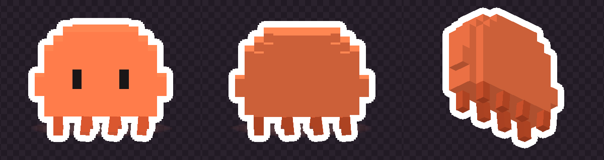

# Claude Bot: Pixel Octo

A transparent, always-on-top desktop companion for Nobara Linux (KDE Plasma, Wayland). A 3D voxel
version of the Pixel Octo emote character reacts to Claude Code activity and system load, shows
tiny CPU/GPU stats and syncs the Dell G15's 4-zone keyboard RGB to its mood.



**Status:** Phase 3 of 7 done. The octo floats on the KDE desktop (transparent, always on top,
click-through except on the octo and its badge, draggable) with 5 moods, face expressions, 13
moves, pixel particles, a heat-coloured thinking-verb badge and rotating emote stickers, and it
looks toward your terminal. Click the badge to open the simulator dock that drives it all
(pressure, moods, moves, emotes, look target, fake temperatures, keyboard strip). Next: the
Python bridge with real keyboard RGB (Phase 4). Full plan: [`PROMPT.md`](PROMPT.md);
progress: [`docs/STATUS.md`](docs/STATUS.md); hardware notes: [`docs/HARDWARE.md`](docs/HARDWARE.md).

## Setup (Nobara / Fedora)

```bash
python3 -m venv .venv && .venv/bin/pip install -r requirements.txt
npm install
```

## Run

```bash
npm run app            # the desktop overlay: click the octo to spin it, drag it anywhere,
                       # click its badge to open the simulator dock
npm run dev:web        # http://127.0.0.1:5173 : the octo + buttons for idle, blink, turnAround, jump, roll
                       # add ?speed=0.1 to the URL to watch every move in slow motion; drag to orbit
.venv/bin/python tools/clean_emotes.py   # rebuild assets/emotes-clean/ from the sticker sheet
```

The overlay runs through XWayland (it relaunches itself with `--ozone-platform=x11`) and renders on
the Intel iGPU, so the RTX 3050 can stay asleep. If XWayland ever misbehaves,
`CLAUDE_BOT_OZONE=wayland npm run app` runs it as a native Wayland window instead (no always-on-top).
Details and measurements: [`docs/HARDWARE.md`](docs/HARDWARE.md).

## Test

```bash
npm test                                   # voxel model, face culling, motion, frame budget, window placement
.venv/bin/python tools/test_clean_emotes.py   # sprite cleaner round trip
```

## Layout

| Path | What |
|---|---|
| `assets/emotes-original/` | the 48 emote PNGs + sticker sheets (reference only, never edited) |
| `assets/emotes-clean/` | 48 clean transparent sprites + `contact_sheet.png` (generated) |
| `tools/clean_emotes.py` | sheet → clean sprites |
| `voxels/octo.json` | hand-authored voxel model (text layers, format in its `about` field) |
| `ui/scene3d/` | `Scene3D.js` renderer, `moves.js` motion library, `voxels.js` model parser |
| `ui/companion.*` | octo + badge + emote sticker, driven by a pressure state |
| `ui/mood/` | mood engine: thresholds, verbs, colours, poses, faces, emote pools, simulator |
| `ui/overlay.*` | the page the desktop window shows (click and drag) |
| `ui/dock.*` | the simulator dock window |
| `app/` | Electron: `main.js` window, `preload.cjs`, `placement.js` (multi-monitor maths), `xinput_shape.py` (click-through) |
| `docs/` | `HARDWARE.md` (Phase 0 report), `STATUS.md` (progress) |

## Art

The Pixel Octo emote pack in `assets/` is the project owner's own character art.
