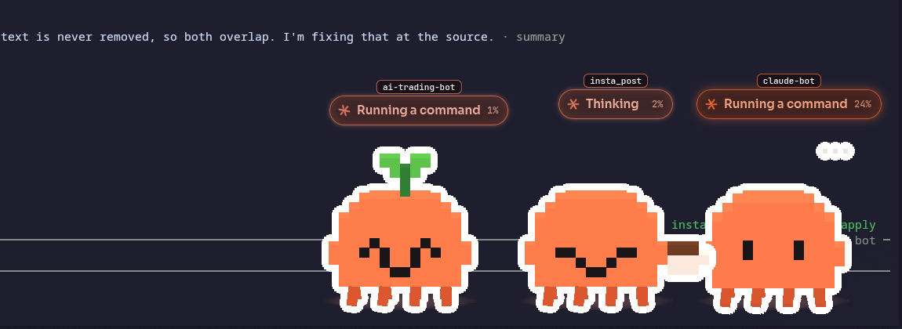
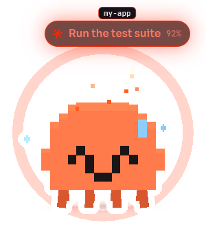
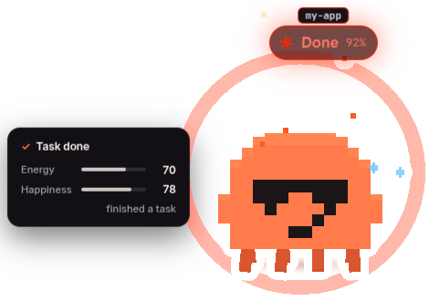
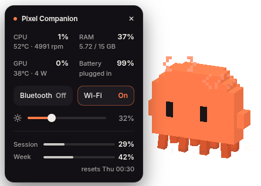

# Claude Bot: Pixel Octo

A small 3D voxel octopus for your desktop that shows what each of your Claude Code sessions is doing, so the
terminals can stay minimised. One octo per running session: it says what its session is working on, comes to
your cursor when the session needs your permission or has finished, and leaves when the session closes.



| What Claude is doing, in its own words | A task finished | Click an octo |
|---|---|---|
|  |  |  |

## What it does

- **One octo per Claude Code session**, labelled with the project folder. It appears when a session starts
  (starting the app if it isn't running) and waves goodbye when the session ends or its terminal is closed.
- **Says what's happening** in Claude's own one-line summary ("Run the test suite", "Editing main.js"), and on a
  permission request, "Needs you: …". Its eyes follow its own session's terminal window.
- **Comes to your cursor** when its session needs a permission, and when it has finished (then only if that
  terminal isn't already in front of you).
- **Reacts to the session**: busy, errors (confused, then relieved when fixed), risky commands, sub-agents,
  a permission left waiting, a nearly full context window, a long task, the token limit getting close.
- **Personalities**: Friendly (default), Dramatic or Calm: the same moments in three styles.
- **Its own feelings**: energy and happiness move with the session (wins, errors, long or late work, rest)
  and pop up in a "Task done" card.
- **Click it** for CPU / RAM / GPU / battery, Bluetooth and Wi-Fi toggles, a brightness slider and your
  Claude Code usage limits (5-hour and weekly). Warnings at 80 % / 95 % usage, hot CPU or GPU, full RAM.
- **Light**: draws on the integrated GPU, hides while the screen is locked (about 1 % of one core), never
  wakes a sleeping NVIDIA GPU to read it.

## Requirements

- **Linux with KDE Plasma 6** (Wayland session; the app uses XWayland). Looking at the terminal, coming to the
  cursor and the brightness slider use KWin / KDE; on other desktops the octos still show but without those.
- **Claude Code** (the hooks and the status line). Usage limits appear with a Claude subscription.
- Python 3.10+, Node.js 22.12+, and the KDE / D-Bus tools `./setup.sh` checks for.
- Tested on Nobara Linux 44 (Fedora-based), Plasma 6.7, Claude Code 2.1.33x, one machine so far.

## Setup

```bash
git clone https://github.com/sssssaud/claude-bot.git
cd claude-bot
./setup.sh
```

`setup.sh` checks the system and, if something is missing, prints the exact `sudo dnf install …` line and stops
(it never runs sudo). Then it installs the Python parts (`.venv`) and the Node parts (with Electron), builds,
runs the tests, and asks before connecting Claude Code. Safe to run again.

## Run

```bash
./run.sh
```

After that, with the hooks installed, it starts by itself whenever a Claude Code session starts. The tray icon has: Hide / Show octos,
Simulator dock, Masti, Come to my cursor, Personality, Feelings, Show details, Start on login, Quit.
Drag an octo anywhere; it remembers the spot per project.

## What it changes on your machine

| Where | What | Undo |
|---|---|---|
| `~/.claude/settings.json` | hooks on 11 Claude Code events + a status line that wraps yours (asked first, backed up) | `python3 hooks/install.py --uninstall` |
| `~/.config/claude-bot/` | window positions and tray settings | delete the folder |
| `~/.config/autostart/claude-bot.desktop` | only if you tick Start on login | untick it |
| `~/.cache/claude-bot.log` | the app's log when a session starts it | delete it |

It listens only on `127.0.0.1:8765` and refuses requests from web pages. Nothing leaves your machine.

## Privacy

The hook sends the app only: the event name, the tool name, yes/no flags, the session id, the project folder's
**name**, the terminal's process ids, and a short detail: Claude's own one-line description of a command or
sub-agent, or a file's **name**. Never your prompts, commands, search text, full paths or messages; anything that
looks like a key or token is dropped. Tray → **Show details** off turns the detail off (e.g. before sharing your
screen). Details: [`hooks/README.md`](hooks/README.md).

## Development

```bash
npm run app            # the octo without the bridge (simulated data); click its badge for the simulator dock
npm run dev:web        # the 3D octo in a browser: http://127.0.0.1:5173 (?speed=0.1 = slow motion)
npm run test:all       # node tests + bridge tests + sprite check
```

| Path | What |
|---|---|
| `app/` | Electron: windows, tray, click-through, KWin helper (`kwin.py`), screen lock |
| `ui/` | the octo page: 3D scene, moods, personalities, popup, simulator dock |
| `bridge/` | local Python service: sessions, moments, feelings, telemetry, controls |
| `hooks/` | the Claude Code hook, the status line wrapper and their installer |
| `voxels/`, `assets/` | the voxel model and the Pixel Octo emote art |
| `docs/` | `STATUS.md` (build log), `HARDWARE.md` (measurements) |

Original spec: [`PROMPT.md`](PROMPT.md) (its keyboard-RGB part was dropped).

## License

Code: [MIT](LICENSE). The Pixel Octo character and its art are **not** MIT: © Shaikh Saud, all rights reserved,
see [`ART-LICENSE.md`](ART-LICENSE.md).
